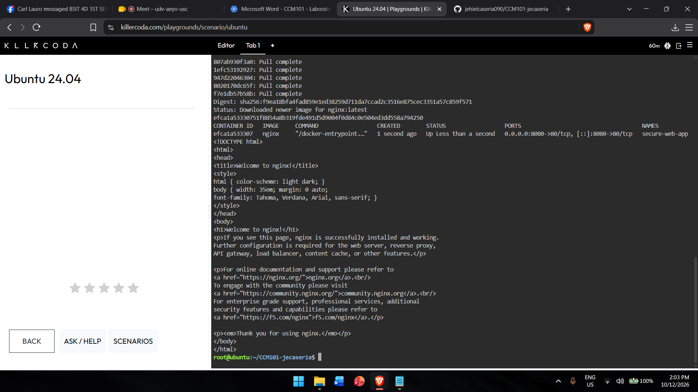

# Laboratory 08 - Cloud Security Engineer

## Mission Overview
As a Cloud Security Engineer at CloudNova Technologies, I secured an exposed Ubuntu server running an Nginx web app (`secure-web-app`) using UFW with a Default Deny policy, allowing only SSH (22) and port 8080.

## Objectives
- Understand the Attack Surface and the Principle of Least Privilege
- Audit open ports on a Linux server
- Configure UFW with a Default Deny policy
- Allow only SSH and HTTP (8080) traffic
- Document firewall rules in Markdown

## Commands Executed
    docker run -d --name secure-web-app -p 8080:80 nginx
    curl http://localhost:8080
    sudo ufw allow ssh
    sudo ufw default deny incoming
    sudo ufw default allow outgoing
    sudo ufw enable
    sudo ufw status verbose
    sudo ufw allow 8080/tcp
    sudo ufw status numbered

## Skills Learned
- Running containers with Docker
- Configuring a host-based firewall with UFW
- Applying Default Deny and least privilege
- Managing ports granularly
- Documenting work in Markdown and using Git/GitHub

## Screenshots

