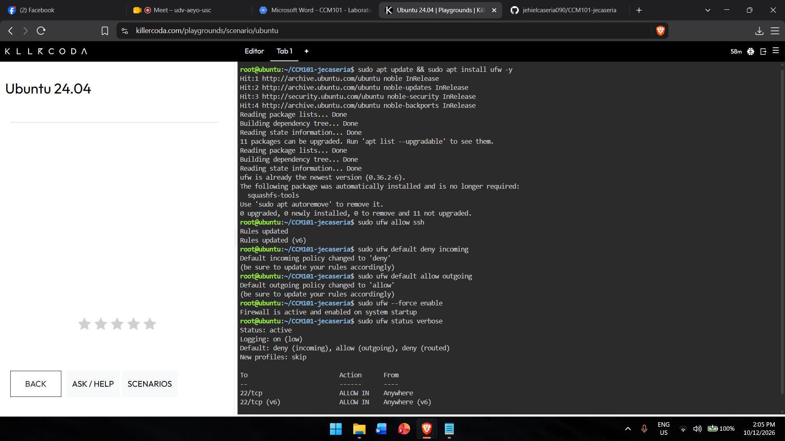
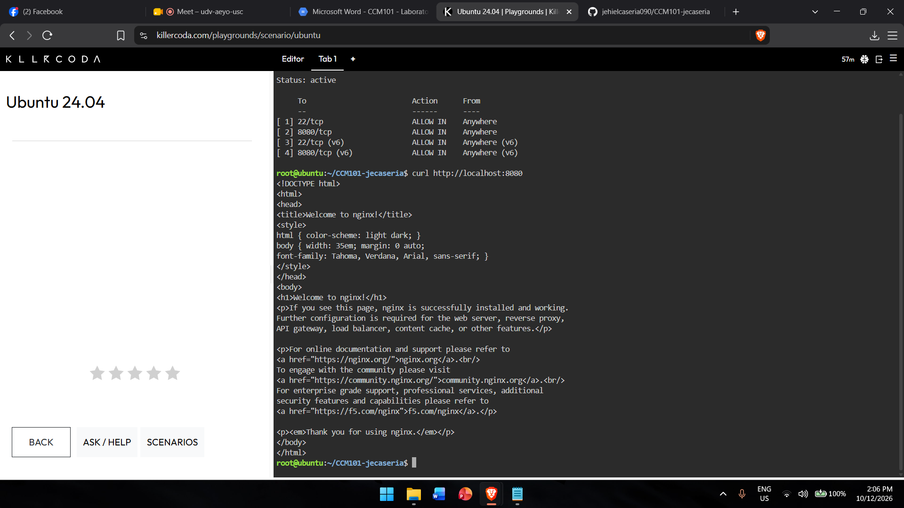

# Firewall Configuration

## Allow SSH
    sudo ufw allow ssh

## Default Deny Policy
    sudo ufw default deny incoming
    sudo ufw default allow outgoing

## Allow Port 8080
    sudo ufw allow 8080/tcp

## What if `ufw enable` ran before `ufw allow ssh`?
The firewall would immediately block all incoming connections, including SSH on port 22, and I would be locked out of my own server.

## Evidence

