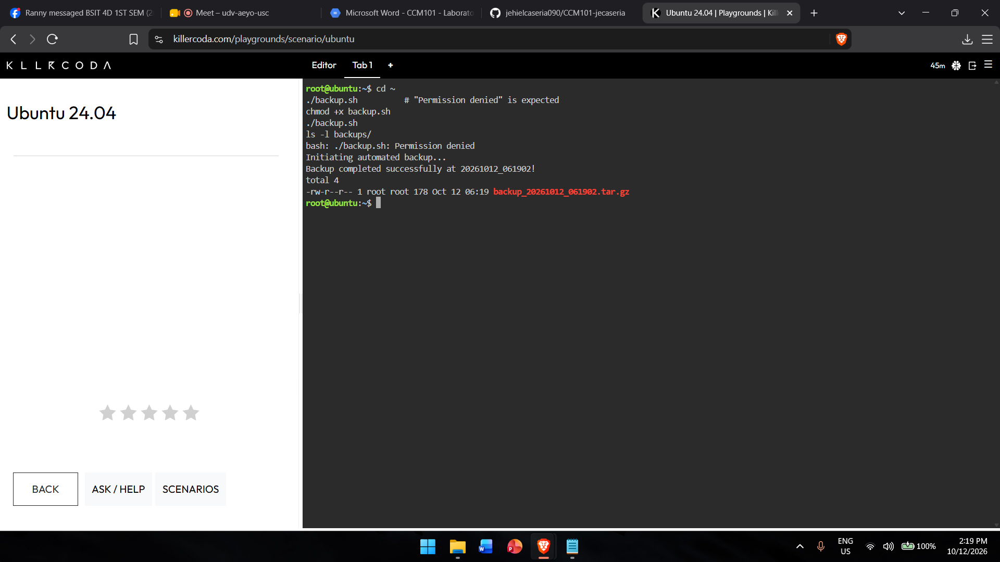
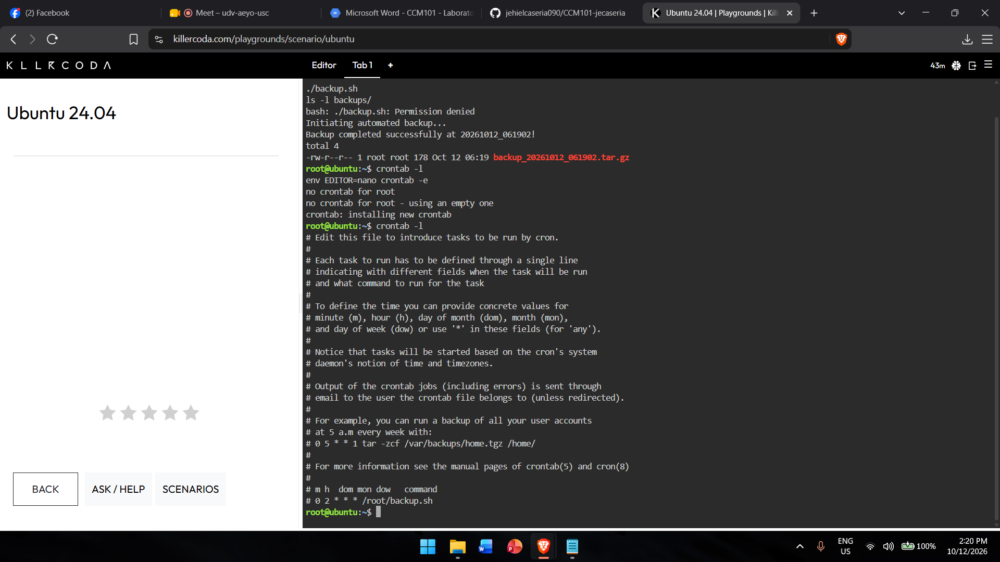

# Backup Script Guide

## backup.sh
```bash
#!/bin/bash
# Automated Backup Script for CloudNova Technologies

SOURCE_DIR="app-data"
BACKUP_DIR="backups"
TIMESTAMP=$(date +"%Y%m%d_%H%M%S")

echo "Initiating automated backup..."

# Create the backup directory if it does not exist
mkdir -p $BACKUP_DIR

# Compress the source directory into a tarball (.tar.gz)
tar -czf $BACKUP_DIR/backup_$TIMESTAMP.tar.gz $SOURCE_DIR

echo "Backup completed successfully at $TIMESTAMP!"
```

## What chmod +x does
(Write 1-2 sentences in your own words: what changed on the file and why it was needed.)

## Cron Expression

| Field | Value | Meaning |
|-------|-------|---------|
| Minute | 0 | At minute 0 |
| Hour | 2 | At 2 AM |
| Day of Month | * | Every day of the month |
| Month | * | Every month |
| Day of Week | * | Every day of the week |

## Evidence


